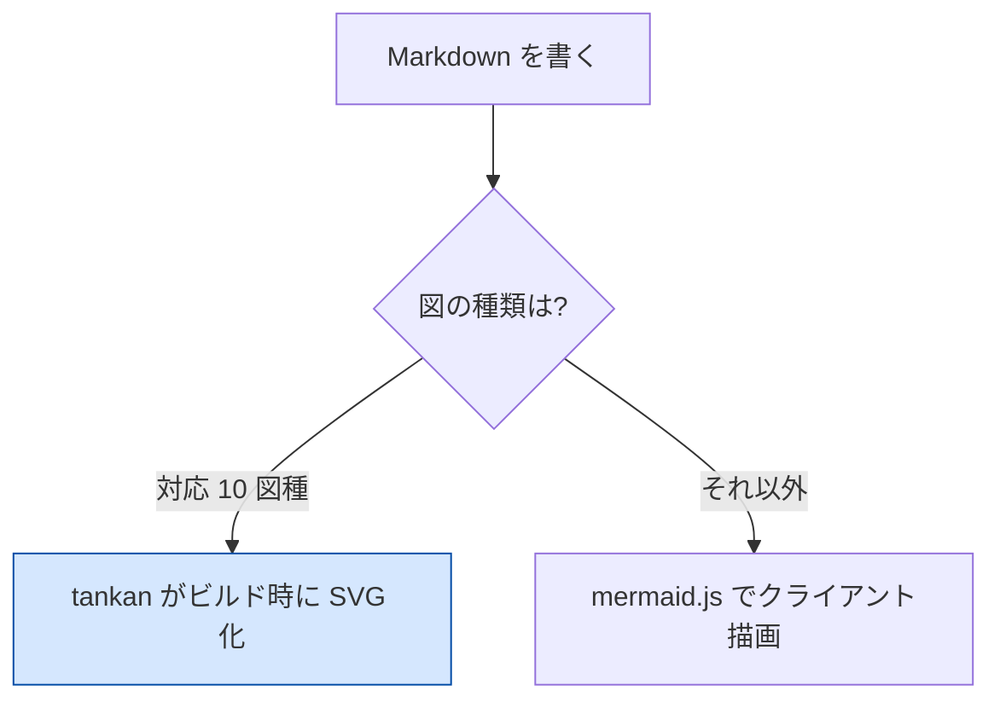
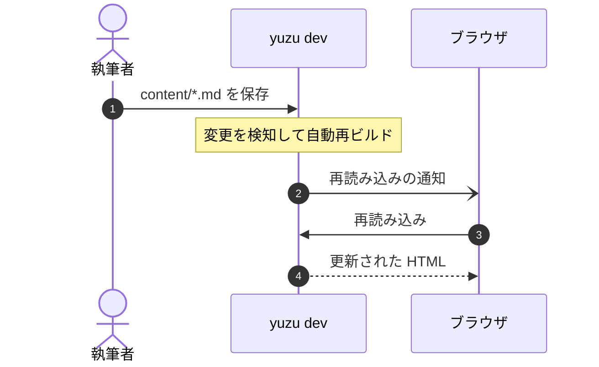
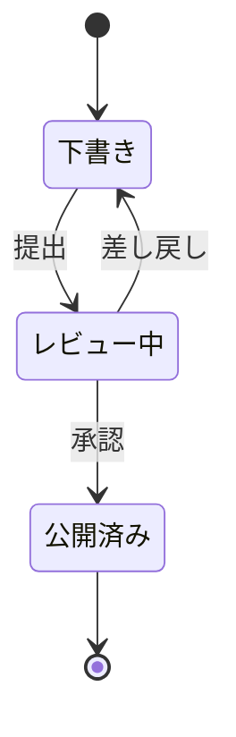
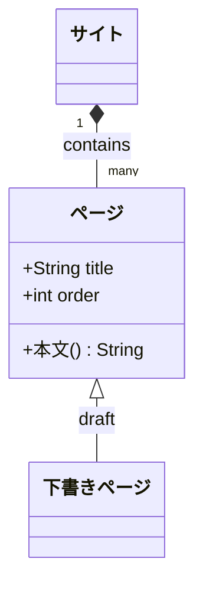
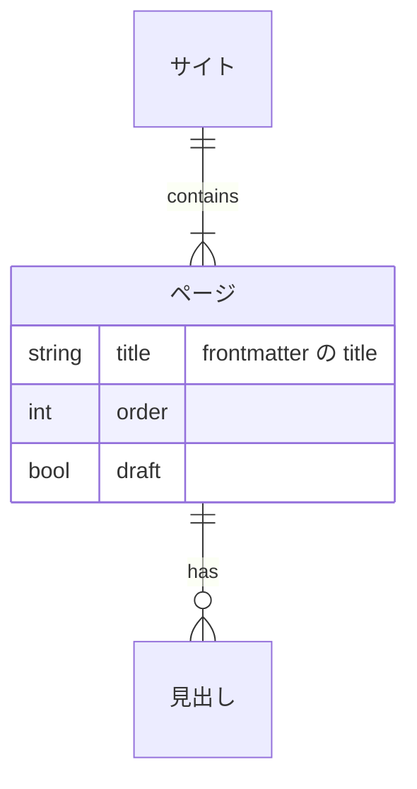
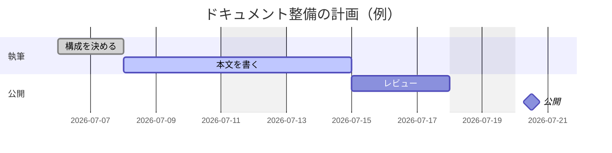
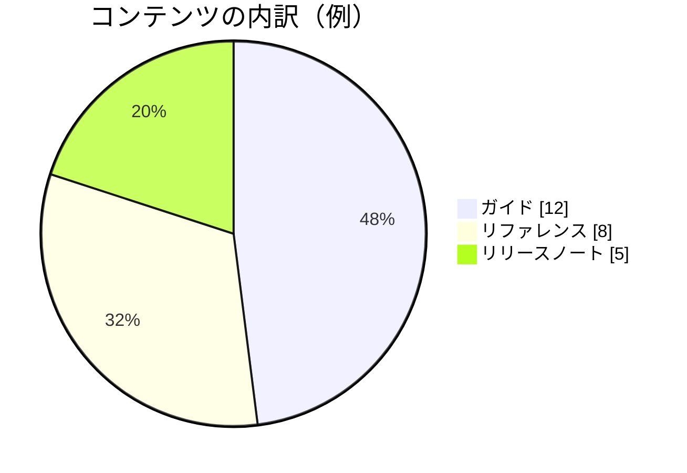
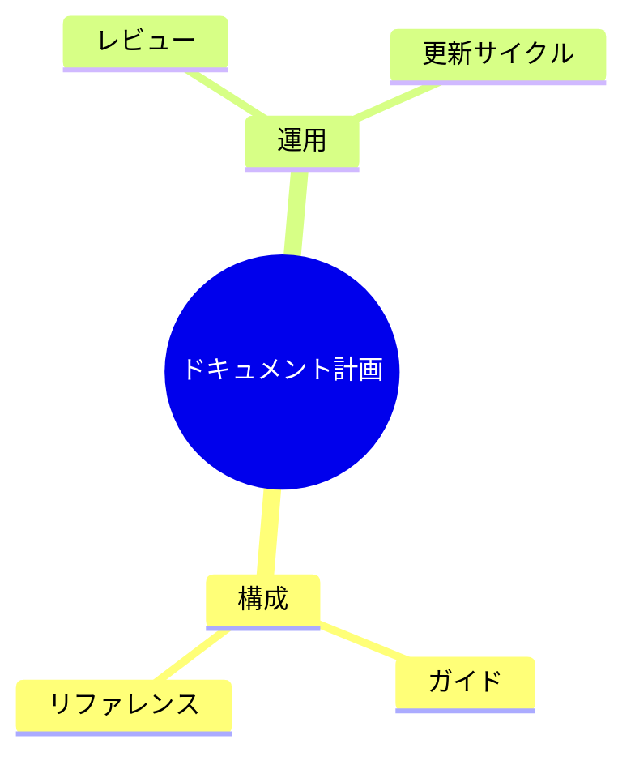
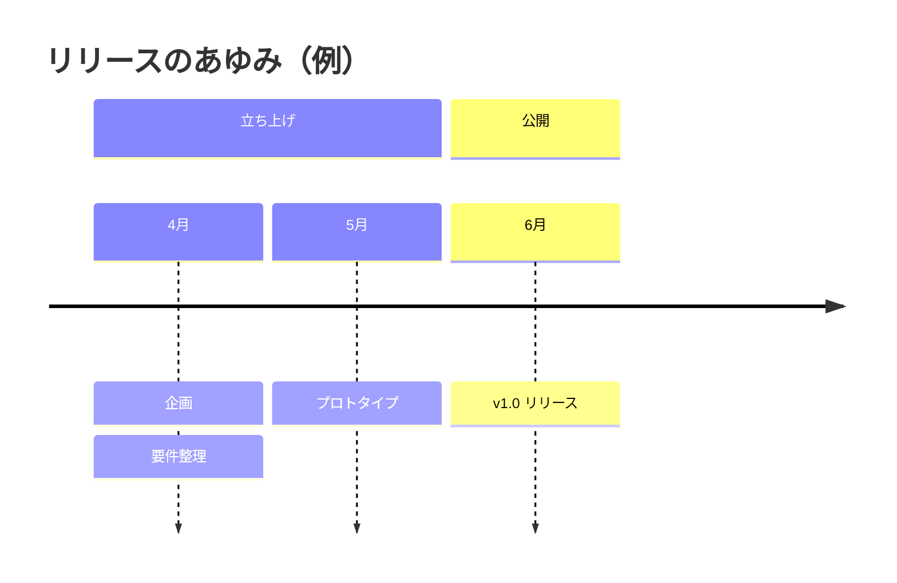
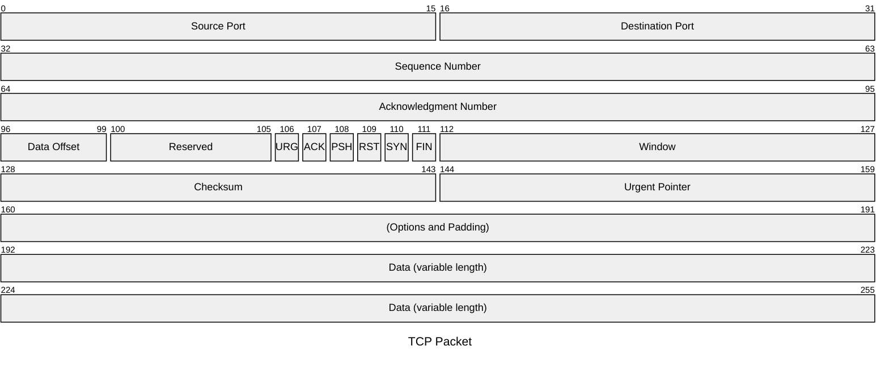

# 図（Mermaid）

` ```mermaid ` ブロックで図が描けます。描き方は 2 つあり、`yuzu.toml` で選びます:

```toml
[markdown.mermaid]
backend = "ssr" # 既定は "client"（ブラウザで描く）。"ssr" はビルド時に SVG にする
```

- **`client`（既定）** — 同梱の mermaid.js がブラウザで図を描きます
- **`ssr`** — yuzu が**ビルド時に SVG にします**。ブラウザの JavaScript は使わず、
  ダークモードの切り替えにも描き直しなしで追従します

## client と ssr の選び方

|  | client（既定） | ssr |
| --- | --- | --- |
| ブラウザの JavaScript | 必要（無効だと図の代わりに Mermaid の原文が出る） | 不要 |
| 読み込むファイル | 全ページで mermaid.min.js（約 3.5 MB）を読み込む（2 ページ目からはブラウザのキャッシュ） | 図の SVG が本文に入るだけ |
| 描ける図 | Mermaid のすべての図種 | 下の 10 図種。それ以外の図は client と同じ描き方になる |
| ダークモードの切り替え | 図を描き直す | 描き直さずに配色が変わる |
| 印刷 | ダークモードのまま印刷すると図だけ暗い配色になる | 常にライトの配色で印刷される |

閲覧する環境で JavaScript が制限されている・ページを軽くしたい・印刷して配る、の
どれかに当てはまるなら `ssr` を選んでください。10 図種以外の図（`journey`・
`gitGraph` など）を多く使うなら `client` のままで構いません（`ssr` にしても、その図は
client と同じ描き方になり、そのページだけ mermaid.min.js を読み込みます）。

このサイトは `ssr` で運用しており、以下の図はすべてビルド時に生成された SVG です。
`ssr` で SVG にできるのは **sequence・flowchart・class・state・ER・gantt・pie・
mindmap・timeline・packet の 10 図種**です。

## flowchart（フローチャート）

`classDef` / `class` / `:::` / `style` のスタイル指定も SSR に反映されます。
指定した色はダークモードでも意図どおり固定され、色付きボックスの文字色は
背景の明度から読みやすい側が自動で選ばれます。



## sequence（シーケンス図）



## state（状態遷移図）



## class（クラス図）



## ER（ER 図）



## gantt（ガントチャート）



## pie（円グラフ）



## mindmap（マインドマップ）

インデント階層で書き、中央のルートから左右へ展開されます。



## timeline（タイムライン）

ロードマップや沿革に向いています。



## packet（パケット図）

ネットワークプロトコルのヘッダーなど、ビット列のフィールド構造を描けます。
frontmatter の `config.packet`（`bitsPerRow` など）にも対応しています。



## フォールバックの挙動

SSR が扱えない図（未対応の図種や `linkStyle` / `click` などの構文）は、
エラーにせず**自動でクライアント描画へフォールバック**します。その場合も
ページ全体のビルドは成功し、mermaid.js はフォールバックが発生したページに
だけ読み込まれます。クライアント描画の図もダークモード切替を監視して
再描画されるため、見た目の追従はどちらの経路でも保たれます。

> [!TIP]
> tankan は yuzu に依存しない汎用ライブラリで、単体でも
> [crates.io で公開](https://crates.io/crates/tankan)しています
> （`cargo add tankan`。I/O なし・時刻 / 乱数非依存・wasm32 対応）。
> 設計の詳細は[アーキテクチャ](../development/index.md)を参照してください。
